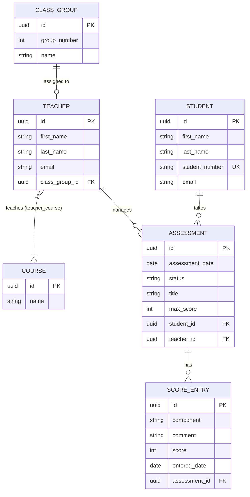

# Student Attendance and Grade Tracker Backend

**Mid-Term Project Examination – Building the Student Attendance and Grade Tracker Backend**  
**Institution:** Adventist University of Central Africa (AUCA)  
**Course:** Web Technology and Internet  
**Student Name:** SHIMA Kelly Guy  
**Student ID:** 27114  
**Project Name:** Student Attendance and Grade Tracker  
**Repository Name:** `student-attendanceand-grade-tracker-backend`  

---

## 1. Project Context & Description

The **Student Attendance and Grade Tracker** replaces manual registers and spreadsheets in a school environment. 

### Key Business Workflow:
- A **Teacher** is the class teacher of one **ClassGroup** and can teach several **Courses** (e.g., Mathematics, Biology, English).
- A **Teacher** plans an **Assessment** for a **Student** on a given date.
- The assessment starts in `PLANNED` status and progresses to `SAT` when attended, terminating as either `GRADED` or `ABSENT`.
- Once an assessment is `GRADED`, the teacher records **ScoreEntry** components (e.g., Quiz, Homework, Participation).

---

## 2. Entity Relationship Diagram



---

## 3. Technology Stack & Database Setup

- **Java Version:** 17 (LTS)
- **Framework:** Spring Boot 3 / 4 (Spring Web MVC, Spring Data JPA)
- **Database:** PostgreSQL 18
- **ORM / Persistence:** Hibernate / JPA
- **Build Tool:** Maven 3.9+ (Wrapper included: `./mvnw` / `.\mvnw.cmd`)

### Database Configuration (`src/main/resources/application.properties`)
```properties
spring.application.name=student-attendanceand-grade-tracker

spring.datasource.url=jdbc:postgresql://localhost:5432/student_attendance_and_grade_tracker
spring.datasource.username=postgres
spring.datasource.password=12345

spring.jpa.hibernate.ddl-auto=update
spring.jpa.show-sql=true

spring.jackson.deserialization.fail-on-null-for-primitives=false
```

---

## 4. Setup & Running the Application

### 1. Database Creation
In PostgreSQL (via `psql` or pgAdmin 4):
```sql
CREATE DATABASE student_attendance_and_grade_tracker;
```

### 2. Run the Application
From the project root:
```powershell
# Windows
.\mvnw.cmd spring-boot:run

# Linux / macOS
./mvnw spring-boot:run
```
The server will start at: `http://localhost:8080`.

---

## 5. Seed Data (Step 0)

The application comes pre-populated with seed data matching all examination requirements:
- **Courses (4):** Mathematics, English, Biology, ICT. (*Nobody holds ICT*).
- **ClassGroups (4):** Group 1, Group 2, Group 3, Group 4. (*Group 4 has no teacher*).
- **Teachers (3):**
  - Robert Mugabe: Class Group 1, holds Mathematics & Biology.
  - Alice Smith: Class Group 2, holds English.
  - David Mugisha: Class Group 3, holds no courses initially.
- **Students (5):**
  - Kelly Shima (`STU-2026-088`)
  - Guy Shima (`STU-2026-089`)
  - Aline Uwase (`STU-2026-090`)
  - Eric Mugisha (`STU-2026-091`)
  - Diane Mutoni (`STU-2026-092`)
- **Assessments (10):** Spread over October & November 2026 covering `PLANNED`, `SAT`, `GRADED`, and `ABSENT`. Robert Mugabe has two assessments on `2026-10-20` (one `ABSENT`, one `GRADED`). Kelly Shima has 4 assessments.
- **ScoreEntries (3):** Attached to GRADED assessments.

---

## 6. Complete API Specification & Requirements

### Part A: Domain Model & CRUD (15 Marks)
- `POST /api/{path}/save` – Returns `201 "[Entity] saved successfully"`
- `GET /api/{path}/all` – Returns `200 OK` with `List<Entity>`
- `GET /api/{path}/{id}` – Returns `200 OK` or `404 Not Found` (`"The [entity] with that id does not exist"`)
- `PUT /api/{path}/update/{id}` – Returns `200 OK` (`"[Entity] updated successfully"`) or `404 Not Found`
- `DELETE /api/{path}/delete/{id}` – Returns `200 OK` (`"[Entity] deleted successfully"`) or `404 Not Found`
*(Where `{path}` can be `courses`, `class-groups`, `teachers`, `students`, or `assessments`)*

### Part B: Derived Queries (15 Marks - Method Name Only)
- **B1**: `GET /api/students/by-last-name?lastName=shima`
  - DERIVED: `findByLastNameIgnoreCaseOrderByFirstNameAsc`
  - Returns students sorted by `firstName` ascending.
- **B2**: `GET /api/assessments/by-status?status=PLANNED`
  - DERIVED: `findByStatusOrderByAssessmentDateAsc`
  - Earliest `assessmentDate` first.
- **B3**: `GET /api/assessments/between?start=2026-10-01&end=2026-10-31`
  - DERIVED: `findByAssessmentDateBetweenOrderByAssessmentDateAsc`
  - Both dates inclusive, ordered by `assessmentDate`.

### Part C: JPQL with Joins (20 Marks - `@Query` with JPQL)
- **C1**: `GET /api/teachers/by-course?name=bio`
  - JPQL: `SELECT t FROM Teacher t JOIN t.courses c WHERE LOWER(c.name) LIKE LOWER(CONCAT('%', :name, '%'))`
- **C2**: `GET /api/class-groups/free`
  - JPQL: `SELECT l FROM ClassGroup l WHERE NOT EXISTS (SELECT p FROM Teacher p WHERE p.classGroup = l) ORDER BY l.groupNumber ASC`
  - Returns Group 4.
- **C3**: `GET /api/courses/unused`
  - JPQL: `SELECT c FROM Course c WHERE c.teachers IS EMPTY`
  - Returns ICT.
- **C4**: `GET /api/students/of-teacher/{teacherId}`
  - JPQL: `SELECT DISTINCT a.student FROM Assessment a WHERE a.teacher.id = :teacherId`
  - Returns distinct students; returns `404 "The teacher with that id does not exist"` if ID is unknown.

### Part D: Business Rules (25 Marks)
- **D1**: `POST /api/assessments/save`
  - Rejects past dates: `400 "Assessment date cannot be in the past"`
  - Rejects duplicate teacher dates (if status != ABSENT): `409 "Teacher already has an assessment on that date"`
  - Always forces new assessment to `PLANNED`.
- **D2**: `PATCH /api/assessments/{id}/status?status=SAT`
  - State transitions allowed: `PLANNED -> SAT or ABSENT`, `SAT -> GRADED or ABSENT`.
  - Rejects invalid moves with `400 "Cannot change status from X to Y"`.
  - `404 "The assessment with that id does not exist"`.
  - General `PUT /api/assessments/update/{id}` cannot modify status.
- **D3**: `PUT /api/teachers/{teacherId}/courses/{courseId}`
  - Adds course to teacher's courses list.
  - Returns `409 "The teacher already has that course"` if already assigned.
  - Returns `404` if teacher or course does not exist.
- **D4**: `PATCH /api/teachers/{teacherId}/class-group?groupNumber=4`
  - Reassigns teacher's class group; old group becomes free.
  - Returns `409 "That class group is taken by another teacher"` if taken.
  - Returns `404` if teacher or groupNumber does not exist.

### Part E: ScoreEntry Entity (15 Marks)
- **E1**: `POST /api/score-entries/save?assessmentId={id}`
  - Body: `{"component": "Quiz", "comment": "Good understanding", "score": 18}`
  - Enforces `GRADED` status: `400 "Score entries are only for GRADED assessments"`.
  - Sets `enteredDate` to `LocalDate.now()`.
- **E2**: `GET /api/score-entries/student/{studentNumber}`
  - JPQL: `SELECT s FROM ScoreEntry s WHERE s.assessment.student.studentNumber = :studentNumber ORDER BY s.enteredDate DESC`
- **E3**: `DELETE /api/score-entries/delete/{id}`
  - Deletes score entry: `200 "Score entry deleted successfully"` or `404 Not Found`.
- **E3 (Protection)**: `DELETE /api/assessments/delete/{id}`
  - Prevents deleting assessments that have score entries: `409 "That assessment has score entries, delete them first"`.

### Part F: Reports and Bulk Updates (10 Marks)
- **F1**: `GET /api/assessments/stats/by-status`
  - JPQL: `SELECT a.status, COUNT(a) FROM Assessment a GROUP BY a.status`
  - Returns counts grouped by status as `List<Object[]>`.
- **F2**: `PATCH /api/assessments/cancel-day?teacherId={id}&date=2026-10-20`
  - Single bulk UPDATE query: `@Modifying`, `@Transactional`.
  - Cancels all non-GRADED assessments to `ABSENT`.
  - Returns `"{count} assessments cancelled"`.

### Bonus Requirements (+10 Marks)
- **Bonus 1 (+5)**: `GET /api/dashboard/summary`
  - Built with [`DashboardService`](file:///c:/Users/Gadget%20store/OneDrive/Documents/auca/webtech/student%20attendance%20and%20grade/src/main/java/auca/tracker/service/DashboardService.java) returning a `Map<String, Long>` JSON object:
    ```json
    {
      "students": 5,
      "teachers": 3,
      "freeClassGroups": 1,
      "assessmentsToday": 2,
      "planned": 3,
      "scoreEntries": 3
    }
    ```
- **Bonus 2 (+5)**: `GET /api/assessments/page?page=0&size=5&sort=assessmentDate,desc`
  - Dynamic `Pageable` endpoint returning `Page<Assessment>` with `totalPages` and `totalElements`.

---

## 7. Postman Collection

The repository includes a ready-to-run Postman collection located at the root:
```
student-attendanceand-grade-tracker-midterm.postman_collection.json
```

### Features of the Collection:
- Organized into folders for **Part A**, **Part B**, **Part C**, **Part D**, **Part E**, **Part F**, and **Bonus**.
- Each request is named by its requirement ID (e.g., `A2`, `B1`, `C4`, `D1`, `D2`, etc.).
- Contains both **success** test cases and **failure test cases (400, 404, 409)** as required by the live demo rubric.
- Preconfigured collection variables (`baseUrl`, `teacherId`, `studentId`, `courseId`, `classGroupId`, `assessmentId`, `studentNumber`).

---

## 8. Git Commit History

The repository maintains an incremental commit history documenting each part:
```
c5b918d Submission: README documentation and complete Postman collection with test cases
9b0e198 Bonus: Dashboard summary and assessment pagination
5caa3aa Part E: ScoreEntry entity, repository, service, and controller
56b17f6 Part A: domain model and CRUD for Course, ClassGroup, Teacher, Student, Assessment
```

---

## 9. Live Demo Notes

For the live demo, you can demonstrate:
1. **Success Cases:** Running queries for B1, C2, C3, C4, D2, E1, F1, Bonus summary.
2. **Failure Cases:**
   - `400 Bad Request`: Status transition violation (e.g., GRADED to PLANNED in D2) or past date in D1.
   - `404 Not Found`: Unknown UUID in GET/PUT/DELETE.
   - `409 Conflict`: Teacher duplicate date in D1, duplicate course assignment in D3, class group already occupied in D4, or deleting an assessment with score entries in E3.
